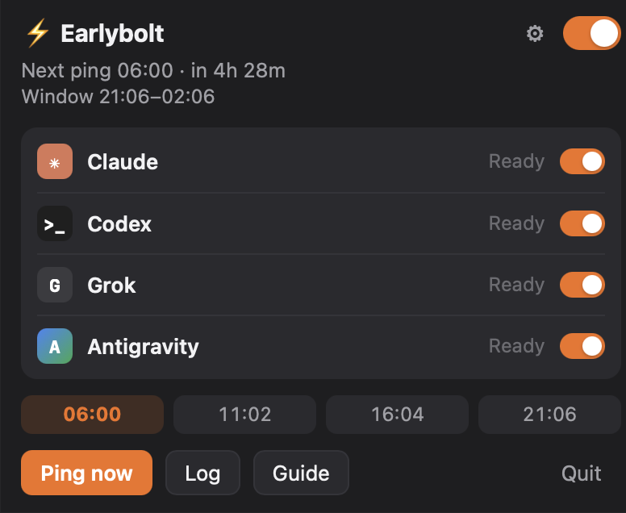
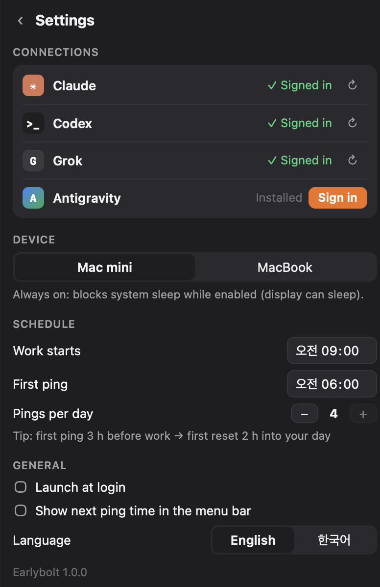

<div align="center">

# ⚡ Earlybolt

**Start your AI subscription's 5-hour usage window *before* you start work — so it resets when you actually need it.**

Claude · Codex · Grok · Antigravity &nbsp;|&nbsp; macOS · Windows &nbsp;|&nbsp; [한국어](#한국어)

 &nbsp; 

</div>

## Install

**macOS** — paste into Terminal:

```bash
curl -fsSL https://raw.githubusercontent.com/tony1010-dev/earlybolt/main/install.sh | bash
```

**Windows** — paste into PowerShell:

```powershell
irm https://raw.githubusercontent.com/tony1010-dev/earlybolt/main/install.ps1 | iex
```

Or download the `.dmg` (macOS) / `-setup.exe` (Windows) from [Releases](https://github.com/tony1010-dev/earlybolt/releases/latest).

> **Why does my system warn about the download?** Earlybolt is free and not code-signed with a paid Apple/Microsoft certificate.
> The one-line installers above avoid the warning. If you download manually:
> **macOS** — open *System Settings › Privacy & Security* and click **Open Anyway**.
> **Windows** — on the SmartScreen dialog click **More info › Run anyway**.

## Why

Claude, ChatGPT (Codex), Grok and Google Antigravity subscriptions limit usage per **5-hour window** (plus a weekly cap). A window doesn't start at a fixed time — it starts **with your first message** and resets 5 hours later.

Start work at 9:00 and your window resets at 14:00. Run out at 11:00 and you're stuck for three hours.

Earlybolt sends a one-word `ok` at **6:00**, so the window resets at **11:00** — right when you need it — and keeps the next windows rolling back-to-back:

| Ping  | Window      |                              |
|-------|-------------|------------------------------|
| 06:00 | 06:00–11:00 | 2 h of work, then a fresh 100% |
| 11:02 | 11:02–16:02 |                              |
| 16:04 | 16:04–21:04 |                              |
| 21:06 | 21:06–02:06 | evening work                 |

Each ping goes out 2 minutes after the previous window ends, so a ping never lands just before a reset. The recommended first ping is **3 hours before you start work**; set your start time and Earlybolt suggests it.

## Features

- **Menu bar (macOS) / system tray (Windows)** app — click ⚡ for the panel, right-click for quick actions
- **One-click setup** — installs each service's official CLI and opens its browser sign-in. No terminal knowledge needed
- **Progress at a glance** — `Pinging 2/4 · Codex…`, then `✓ 4/4 succeeded`
- **Always-on vs. laptop modes**
  - *Mac mini / Desktop*: blocks system sleep while on (the display can still sleep)
  - *MacBook / Laptop*: wakes the computer before pings (Windows: before every ping; macOS: before the first ping of the day)
- **On/off switch**, per-service switches, up to 4 pings a day, launch at login
- **English / 한국어**
- **Uses barely any quota** — the lightest model, a one-word reply

## Getting started

1. Click **⚡** in the menu bar / tray.
2. Open **⚙ Settings** and click **Install** next to the services you use.
3. Click **Sign in** — your browser opens; sign in with your email or Google account as usual. Close the terminal window that appears afterwards.
4. Set **Work starts**; click **Use 06:00** (or whatever it recommends). Done.

## Privacy & safety

- Earlybolt **never sees or stores your credentials**. Sign-in is handled entirely by each vendor's official CLI ([Claude Code](https://code.claude.com), [Codex CLI](https://github.com/openai/codex), [Grok CLI](https://x.ai/cli), [Antigravity CLI](https://antigravity.google)).
- A ping is just the official CLI asked to reply `ok`, on your own machine, with your own account — the same as typing it yourself.
- Install buttons run each vendor's official install script (`claude.ai/install.sh`, `chatgpt.com/codex/install.sh`, `x.ai/cli/install.sh`, `antigravity.google/cli/install.sh`, or the `.ps1` equivalents on Windows).
- No telemetry. Settings and logs stay on your computer.

## FAQ

**Does it work while my computer is asleep?** No — nothing can. Use *Mac mini / Desktop* mode on an always-on machine, or *MacBook / Laptop* mode with **Set wake**. A slot missed by more than 10 minutes is skipped so your day's schedule doesn't shift.

**A ping failed.** Usually the sign-in expired. Open Settings and click **Sign in** (or ↻) again. The log (**Log** button) shows the CLI's error.

**Headless Mac mini?** Turn on *System Settings › Users & Groups › Automatically log in* — Earlybolt runs in your logged-in session.

**Windows laptop doesn't wake?** Enable *Power Options › Change plan settings › Advanced › Sleep › Allow wake timers*.

**Where are settings and logs?**
macOS `~/Library/Application Support/com.earlybolt.app`, `~/Library/Logs/com.earlybolt.app` ·
Windows `%APPDATA%\com.earlybolt.app`, `%LOCALAPPDATA%\com.earlybolt.app\logs`

## Uninstall

- **macOS**: quit Earlybolt (⚡ › Quit), move `Earlybolt.app` to the Trash.
- **Windows**: *Settings › Apps › Installed apps › Earlybolt › Uninstall*.

If you set a laptop wake schedule, click **Remove** in Settings first.

## Build from source

Requires [Rust](https://rustup.rs) and Node.js 20+.

```bash
npm install
npm run dev      # run
npm run build    # bundle (.app/.dmg on macOS, .exe on Windows)
```

`earlybolt --run-once` pings every service once without UI and prints the result — handy for testing.
Releases are built by GitHub Actions when a `v*` tag is pushed (`.github/workflows/release.yml`).

## Disclaimer

Earlybolt is an independent project, not affiliated with or endorsed by Anthropic, OpenAI, xAI or Google. Product names are trademarks of their owners. Usage limits and terms are set by each provider and may change; use Earlybolt in line with your plan's terms.

## License

[MIT](LICENSE)

---

## 한국어

**AI 구독의 5시간 사용량 창을 출근 전에 미리 열어, 정말 필요할 때 리셋되게 해 주는 앱입니다.**
Claude · Codex · Grok · Antigravity / macOS · Windows 지원.

### 설치

**macOS** — 터미널에 붙여넣기:

```bash
curl -fsSL https://raw.githubusercontent.com/tony1010-dev/earlybolt/main/install.sh | bash
```

**Windows** — PowerShell에 붙여넣기:

```powershell
irm https://raw.githubusercontent.com/tony1010-dev/earlybolt/main/install.ps1 | iex
```

[Releases](https://github.com/tony1010-dev/earlybolt/releases/latest)에서 직접 받을 수도 있습니다. 유료 서명이 없는 무료 앱이라 직접 받으면 경고가 뜹니다. 위 한 줄 설치는 경고가 뜨지 않습니다.
직접 받았다면 **macOS**: *시스템 설정 › 개인정보 보호 및 보안 › 그래도 열기* / **Windows**: SmartScreen 창에서 *추가 정보 › 실행*.

### 왜 필요한가요?

5시간 창은 정해진 시각이 아니라 **첫 메시지를 보낸 순간** 시작돼 5시간 뒤 리셋됩니다. 9시에 일을 시작하면 14시에야 리셋되죠. Earlybolt가 **6시에 "ok" 한 마디**를 미리 보내 두면 **11시에 리셋**되고, 이후 창이 끝나고 2분 뒤마다 다시 호출해 창이 끊김 없이 이어집니다 (06:00 → 11:02 → 16:04 → 21:06). 추천 첫 호출은 **업무 시작 3시간 전**입니다.

### 사용법

1. 메뉴 막대 / 트레이의 **⚡** 클릭
2. **⚙ 설정**에서 쓰는 서비스의 **설치** 클릭 (각 회사 공식 CLI 자동 설치)
3. **로그인** 클릭 → 브라우저에서 평소처럼 이메일·Google 로그인
4. **업무 시작** 시각을 정하고 추천 첫 호출 **적용** — 끝

- **맥미니 / 데스크톱 모드**: 켜져 있는 동안 시스템 잠자기만 막습니다(화면은 꺼져도 됨).
- **맥북 / 노트북 모드**: **자동 깨우기**로 호출 직전에 깨웁니다 (Windows는 매 호출, macOS는 하루 첫 호출).
- 호출 진행 상황이 `호출 중 2/4 · Codex…` → `✓ 4/4 호출 성공`으로 표시됩니다.
- 설정 › 언어에서 **한국어**를 고르세요.

### 안전한가요?

비밀번호는 Earlybolt가 보거나 저장하지 않습니다. 로그인은 각 회사의 공식 CLI가 처리하고, Earlybolt는 내 컴퓨터에서 내 계정으로 그 CLI에 "ok"를 요청할 뿐입니다. 사용 기록 수집도 없습니다.

### 제거

**macOS**: ⚡ › 종료 후 `Earlybolt.app`을 휴지통으로 · **Windows**: 설정 › 앱 › 설치된 앱 › Earlybolt › 제거
